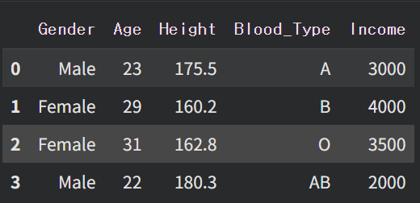
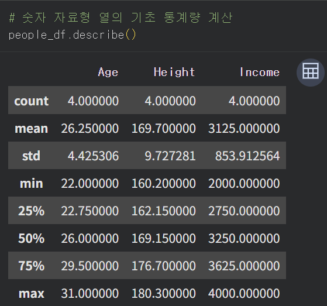
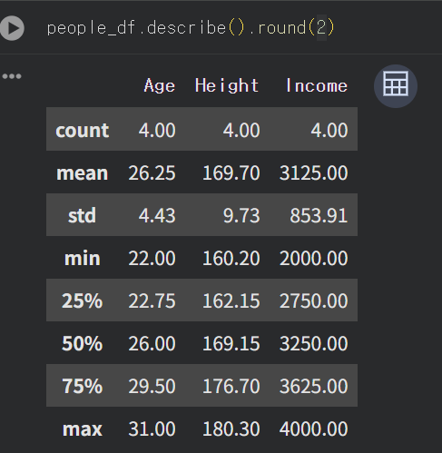
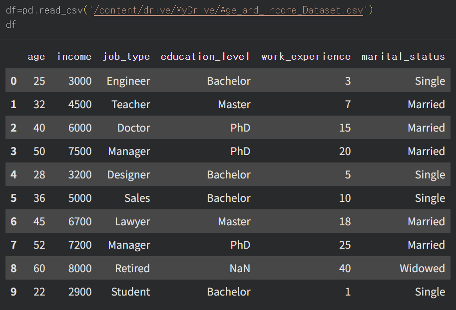
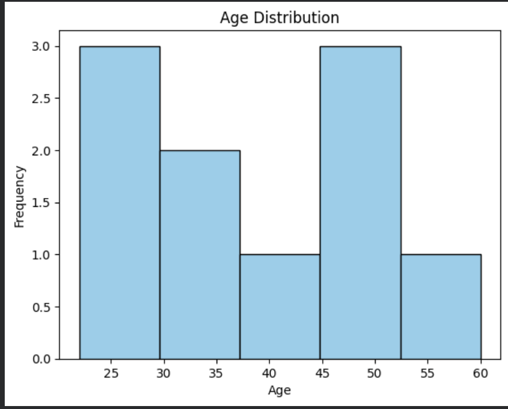
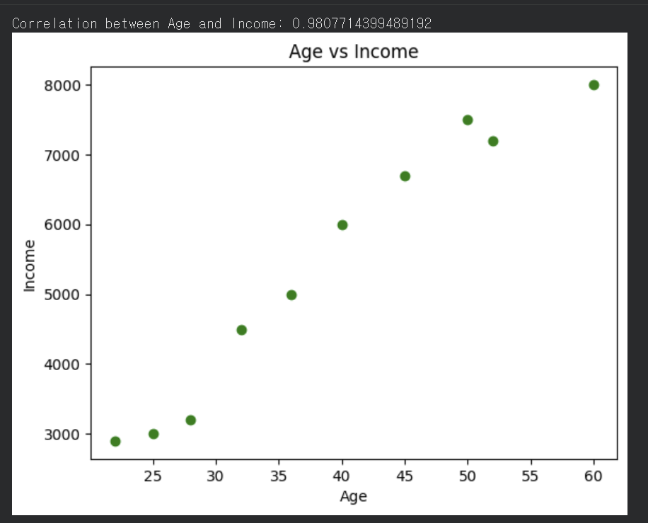

### 오늘의 TIL (2026.10.30)

## 1. domain insight 

https://www.hankyung.com/article/2026102944211

# 내비 1위 티맵, 골드만삭스에 팔린다

요약 : 골드만삭스가 티맵을 사 최대주주가 되어 경여권을 차지하려 하고 있다. 현 티맵모빌리티의 최대주주인 SK스퀘어는 AI와 반도체에 더욱 집중하기 위해 7000~8000억 사이에 협상을 생각중이며, 경영구너을 넘긴 뒤에는 주주로서 AI와 반도체 분야에서 티맵과 같이 협력해갈 것을 밝혔다 

Q1. 운영 전문성이 없는 골드만이 경영해도 될까? 홈플러스 같은 사태가 발생할 수 있지 않을까?

A. PE는 직접 운영하지 않고 전문 경영인을 둔다. 진짜 리스크는 차입 인수이다. 

차입매수 : 인수 대상 기업의 자산이나 미래 현금 흐름을 담보로 대규모 부채를 조달하여, 적은 자기자본으로 기업을 인수하는 방법 

### (부록) 차입매수 vs 부동산PF 

    ㄴ 비슷한 점 :  - 적은 자기자본 + 대부분 대출로 채운다  
                  - 상환 재원이 미래에 있다 (LBO는 인수한 회사가 벌 돈, PF는 미래 건물의 분양 대금)
                  - 금리에 취약함 - 이자 부담은 커지고 자산 가치는 떨어진다
    ㄴ 다른 점 : - 담보대상 유 무 
                ㄴ LBO 담보대상 : 인수한 회사 
                ㄴ PF 담보대상 : 존재하지 않음 

                - 현금흐름
                ㄴ LBO : 인수직후
                ㄴ PF : 분양 후 
                
                - 리스크 전이
                ㄴ LBO : 인수된 회사 
                ㄴ PF : 시공사, 증권사, 저축은행


LBO 위험도 판단 

   1. 부채 / EBITDA : 빛을 몇년치 수익으로 갚을 수 있나 
   2. EBITDA / 이자비용 : 번 돈으로 이자를 감당할 수 있는가 

EBITDA : 이자, 세금, 감가상각비를 빼기 전 이익 


# 반도체로만 106조원 벌어…"삼성전자 내년 HBM 1위"

https://www.hankyung.com/article/2026102944201

요약 : 삼성전자가 단일 분기 영업이익 100조원을 찍은 대기록을 찍었다. 6세대 HBM4가 주력상품으로 4분기 HBM 점유율 1등이 될 것으로 전망된다. 삼성전자는 D램의 점유율처럼 같은 수준의 HBM의 점유율을 확보했다고 말했다. 현재 삼성전자는 내년 HBM 물량 역시 완판했으며 대형 고객사 10곳과 장기공급계약을 완료했으며 추가 10곳과 협상을 진행중이다. 반면 가전과 모바일을 담당하는 DX부문은 8000억원의 영업손실을 냈다. 100조에 달하는 주주환원책중 30조원 규모 현금배당안을 의결했으며 나머지에 대한 실행안은 내년 초 4분기 실적 발표 때 공개 예정이다. 


Q1. 전년 동기 대비 매출이 126% 영업이익이 781% 올랐다는 것은 D램의 값이 그만큼 올라 더 큰 영업이익을 챙겼다는건가? 

A. 반도체는 고정비용이 굉장히 큰 산업이다. 이번에 D램 값이 올라가게 되면서 고스란히 이익이 올라가게되었다. (비용 증가 따로 x)

### (부록) 영업레버리지(고정비효과)
-----

- 양날의 검
    
    ㄴ 가격이 오를 때는 고스란히 영업이익으로 가지만 가격이 떨어질 때는 이익이 매출보다 훨씬 빠르게 무너진다 


Q2. sk하이닉스는 어제 기사에서 80조 가까운 영업이익을 냈다는 기사를 보았는데 삼성은 어떤 차별점이 하이닉스보다 30조가량 더 높은 영업이익을 내게 했을까?  

A. 영업이익 = 매출 * 이익률

이익률은 하이닉스가 70~80%로 높다. 하지만 삼성은 D램, 낸드 생산능력이 세계 1위라 파는 양에서 앞선다 
결국 하이닉스는 효율(HBM 중심의 높은 이익률)로, 삼성은 덩치(생산능력)으로 번다.


Q3. 왜 호황인 DS에 반면 DX는 적자일까? 

A. 핸드폰, 노트북 등 다른 가전에서도 메모리가 들어간다. 현재 최고가를 찍고 있는 이들이기에 위 부품들을 사와 만들어야하는 DX입장에서는 불리할 수 밖에 없는 구조로 추정된다. 

생각해볼점 - DX가 반도체를 구매한 것은 회계상으로 내부거래에 속해 회사전체적으로 봤을 때 상쇄된다. 


## 2. 데이터, 변수 - 분류(Classification)

학습 - 데이터를 가지고 최적의 파라미터를 찾아가는 과정

추론 - 예측값을 뽑아내는 과정 

런타임 - 사용자가 작성한 코드가 실제로 실행되는 독립된 가상 컴퓨터 

세션 - 사용자의 로그인 상태나 활동 정보를 서버에 임시 저장해 두는 기술 
    
    ㄴwhy? : HTTP는 요청마다 서버가 사용자를 기억하지 못하는 구조라서, 로그인 상태를 유지하려면 별도로 그 정보를 어딘가에 저장해뒀다가 매 요청마다 확인할장치가 필요하기 때문

-----

- 데이터 구조적 유형(정형/비정형)
    
    ### 정형데이터 
    
    ㄴ 지정된 행과 열로 이루어진 테이블 형태 

    **행**(개체/관측치/기록/사례/경우)

    explain. 행은 각 학생들 한 명 한 명을 나타내기 때문에 개체/사례/경우 

    **열**(특성/속성/변수) 

    explain. 열은 모든 학생들이 가지고 있는 값이기 때문에 속성/특성 

    #### **시계열 데이터** 

    ㄴ **시간 순서**에 따라 관측, 기록된 데이터 

    ㄴ *시계열 데이터의 분석은 시각화가 중요하다*
        ㄴ 단순한 통계 요약값만으로는 시계열 데이터의 핵심 패턴을 포착할 수 없기 때문

    #### **시퀀스 데이터**

    ㄴ 순서대로 정렬된 데이터의 연속  

    ㄴ'순서가 중요한 데이터' 

    ### 비정형 데이터 

    ㄴ 데이터의 형식과 구조가 변경될 수 있는 데이터로 데이터의 구조 정보를 데이터와 함께 포함하여 저장하는 데이터 

### (부록) 이미지는 왜 비정형 데이터일까?
-----
Q. 이미지에 나타난 각각의 픽셀값으로 저장하는거면, 결국 표로 나타낼 수 있는 거 아닐까?

A. 정형 데이터는 열순서를 바꿔도 의미가 보존되지만, 이미지는 픽셀 위치가 바뀌면 의미 자체가 깨진다는 것이 핵심

### (부록) 비정형/정형 어떤 것이 더 중요할까?
---
A. 여전히 은행에서 핵심 시스템은 거의 전부 RDBMS 기반의 정형 데이터로 돌아간다. 비정형 데이터가 늘어난다고 정형 데이터의 중요도가 사라지는 건 아니다. 

**RDBMS(Relational Database Management System)**: 데이터를 여러 개의 표로 나눠서 저장하고, 그 표들 사이를 관계로 연결한다. 
-----


변수: 분석 대상이 되는 개체들이 가지고 있는 고유한 특성, 속성


- 변수 유형(범주형/수치형)
- 변수 역할(종속변수/독립변수)

    ㄴ 종속변수 : 다른 변수에 의해 영향을 받는 변수

    ㄴ 독립변수 : 종속 변수에 영향을 미치는 변수, 독립적으로 조작되거나 변화할 수 있는 변수 
    
- 데이터 타입(int/float/bool/string)

    


## 3. DATA 실습

    import pandas as pd 

    data = {
        'Gender' : ['Male', 'Female', 'Female', 'Male'],
        
        'Age' : 
        [23, 29, 31,22],

        'Height' : [175.5, 160.2, 162.8, 180.3] , 

        'Blood_Type' : ['A', 'B', 'O', 'AB']

        'Income' : [3000, 4000, 3500, 2000]

    }

pandas : 표 형태의 데이터를 다루기 위한 파이썬 라이브러리 

    ㄴ Series : 하나의 열에 해당하는 1차원 데이터

    ㄴ DataFrame : 여러 Series들이 모인 2차원 표 

딕셔너리 : 키(key)와 값(value)을 한 쌍으로 묶어서 저장하는 자료구조 

    ## 딕셔너리 생성
    '''python
    student = {
        '이름': 'CHANSOO',
        '나이' : 00,
        '전공' : '경제학'
    }

    student
    '''

    **출력**
    '''
    {'이름':'CHANSOO','나이':0,'전공':'경제학'}

    ## 인덱싱

```python
print(student['이름'])
```
**출력:**
```
CHANSOO
```

## 값 추가 및 수정

```python
student['나이'] = 30
student
```
**출력:**
```
{'이름': 'CHANSOO', '나이': 30, '전공': '경제학'}
```

```python
student['키'] = 160
student
```
**출력:**
```
{'이름': 'CHANSOO', '나이': 30, '전공': '경제학', '키': 160}
```

## 값 삭제

```python
del student['키']
student
```
**출력:**
```
{'이름': 'CHANSOO', '나이': 30, '전공': '경제학'}
```

## 이름/값/쌍 전체 꺼내기

```python
print(list(student.keys()))
```
**출력:**
```
['이름', '나이', '전공']
```

```python
print(list(student.values()))
```
**출력:**
```
['CHANSOO', 30, '경제학']
```

```python
print(list(student.items()))
```
**출력:**
```
[('이름', 'CHANSOO'), ('나이', 30), ('전공', '경제학')]
```

```python
for key, value in student.items():
    print(f'{key}:{value}')
```
**출력:**
```
이름:CHANSOO
나이:30
전공:경제학
```


    import pandas as pd 
    import numpy as np 
    import matpotlib.pyplot as plt 
    from IPython.display import display

Numpy : 숫자 배열을 빠르게 계산하기 위한 라이브러리

Matplotlib : 그래프를 그리는 시각화 라이브러리

IPython : '더 똑똑한 파이썬 실행 환경' 

```python
data = {
    'Gender': ['Male', 'Female', 'Female', 'Male'],
    'Age': [23, 29, 31, 22],
    'Height': [175.5, 160.2, 162.8, 180.3],
    'Blood_Type': ['A', 'B', 'O', 'AB'],
    'Income': [3000, 4000, 3500, 2000]
}
```
첫번째 사람에 대한 정보는 딕셔너리 자체가 알아서 연결해주는 것이 아니라 우리가 그렇게 순서를 맞춰서 입력했기 때문 

```python
people_df = pd.DataFrame(data)
```


ㄴ 결과 : 행 4개는 사람 4명, 열 5개는 각 사람의 특성 5개 

```python
people_df.describe()
```


ㄴ 숫자 자료형의 기초 통계량

```python
people_df.describe().round(2)
```


### Q. 만약 round(-1)이면 결과값은? 

round() : ()의 자리로 반올림해라 

round(2): 소수점 둘 째 자리
round(0): 소수점 없이 정수로
round(-1) : 일의 자리를 버리고 10의 자리로 반올림 




    히스토그램 그리기
    ```python 
    import matplotlib.pyplot as plt 

    plt.hist(df['age'],bins=5, color='skyblue, edgecolor="black")

    plt.title('Age Distruibution')

    plt.xlabel('Age')

    plt.ylabel('Frequency')

    plt.show()




다변량 분석
```python
correlation = df['age'].corr(df['income'])
print(f"Correlation between Age and Income : {correlation}")
```

산점도 그리기
```python
plt.scatter(df['age'],df['income'],color='green')
plt.title('Age vs Income')
plt.xlabel('Age')
plt.ylabel('Income')
plt.show()




종속변수와 독립변수 

```python
from sklearn.linear_model import LinearRegression

import numpy as np 

y = df['income'].values 

X = df[['age']].values

#X는 특성이 하나뿐이어도 표 형태(2차원)를 유지해야 해서 대괄호 2개, y는 예측하려는 값 하나만 있으면 되니까 리스트 형태(1차원)로 대괄호 1개 

model = LinearRegression()
#직선 하나 그어줄 도구 꺼내기
model.fit(X,y)
# X와 y 데이터를 보여줄테니, 이 점들을 가장 잘 관통하는 직선 찾아내

predicted_income = model.predict(X)
# 학습이 완료된 모델에게 값을 부여해서 예측해본다

plt.scatter(X,y,color='blue', label = 'Actual Income')

plt.plot(X,predicted_income, color='red', label = 'Predicted Income')
plt.title('Income vs Age with Linear Regression')
plt.xlabel('Age')
plt.ylabel('Income')
plt.legend()
#작은 범례 박스 생성
plt.show()

