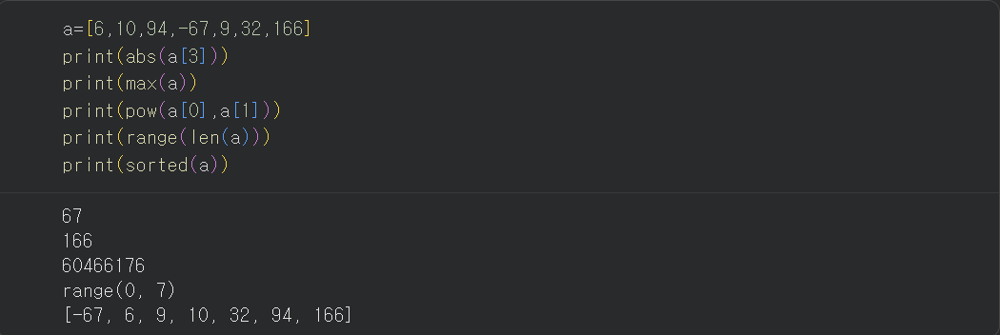

### 오늘의 TIL (2026.11.02)

## 1. domain insight 

https://www.hankyung.com/article/2026110185951

# "돈이 마르기 시작했다" ... AI 열풍에 닥친 '초대형 위기'

요약: 앤트로픽이 상장 직전에 놓였는데 현재 전세계적으로 자금경색이 일어나 AI인프라에 대한 투자가 붕괴될 수도 있다는 전망이 나오고 있다. 자산운용사 블랙스톤이 최근 앤트로픽에 대한 신용등급을 '투기등급'인 BB로 평가할 가능성이 높다고 파이낸셜타임즈가 발표했다. 이로 인해 미국 보험사나 연기금은 앤트로픽에 대한 회사채 구매를 제한할 수밖에 없고 그 결과 앤트로픽은 자금 조달이 굉장히 힘든 상황에 부딪혔다 . 현재 건설되고 있는 대부분의 AI데이터센터는 상당수가 앤트로픽이 발주한 것이다. 오픈AI의 상황도 비슷한데 상장 전 마지막 투자 유치로 300억달러를 목표했지만 110억달러만 모였고 이 후 목표액을 낮추고 개인투자자들에게도 손을 빌렸다. 현재 메타 역시 흔들리고 있는데 이유는 AI를 수익화하지 못했기 때문이다. 이 같은 소식에 반도체주도 흔들리고 있다. 


***요약 정정**

   - 등급을 매기는 주체 : 블랙스톤은 신용평가사가 아닌 자산운용산이다. 엔트로픽에 투자한 측이고, 앤트로픽측에서 투자자들에게 BB등급이 나올 것 같다고 전망을 전한 것
   - 자금 조달이 굉장히 힘들다 : 현재 이미 1120억 달러 이상의 현금을 보유하고 있으며 IPO(주식상장)시 약 1000억 달러가 추가로 발행된다. 현재 상황으로는 채권이나 대출이 가능하지만 비싸진 상황이라 굉장히는 아니다.(가능은 하다)

Q1. 엔트로픽에 대해 신용등
급 BB로 평가하는 근거는 무엇일까? 
A. 신용등급은 성장성이 아닌 '빚을 확실히 갚을 수 있냐'의 척도로 평가 
    
근거로 제시된 것은 3개이고 

    ㄴ KBRA는 현금흐름과 EBITDA 자료 확보를 못해, 제한된 정보로 평가했음
    ㄴ 미래 인프라 지출로 약정한 금액이 5180달러
    ㄴ 매출은 급증했지만 순손실도 그만큼 크다

Q2. 상장 전에 왜 투자 유치가 필요할까? 

A. IPO 준비는 시간이 걸리는데, 그동안에도 칩과 데이터센터 비용을 계속 지불해야하기에 **당장의현금이 필요해서 그리고 회사 가치의 기준점**을 만들기 위해서 

    ㄴ그러면 오픈AI가 300억달러의 투자목표금액을 다 채우지 못한 것도 현재 투자자들이 볼 때 그정도의 가치를 가지고 있지 않다는 의미일까?

    - 목표 미달 가능한 원인 3가지 
    
    1. 가격이 비싸다(회사는 좋은데 1.4조 달러는 과하다)
    2. 시장에 돈 마름(금리 상승, 자금경색)
    3. 경쟁 투자처(오픈AI의 경우 앤트로픽이 IPO로 인해 1000억 달러 흡수 예정)


Q3. 상장 전 기업도 재무제표를 볼 수 있나? 

A. 미국: S-1을 내야 상장을 할 수 있기에 SEC EDGAR에서 무료로 볼 수 있다
   
   한국: 일정 규모 이상의 비상장사는 DART에 감사보고서가 올라온다. 


Q4. 반도체주가 살아남을 방법은?

A. 장기공급계약, 공급 조절, 수요처 다변화 


# 한국 수출 첫 9000억 달러 돌파 ... 연수출 1조 달러 보인다

요약: 한국이 올 해 1~10월 해외수출액이 누적으로 9000억달러에 도달했고 11월정도에 1조달러를 달성할 것으로 보고 있다. 여기의 일등공신은 단연코 반도체이며 지난달 수출은 564억달러로 두 달 연속 500억달러를 웃돌았다. 

Q1. 수출은 역대 최고 호황을 맞이했는데 너무 반도체에 의존하고 있는 거 아닐까?   

A. 9월 수출 1209억 달러 중 반도체가 603억달러로 절반이다. 만약 반도체 가격이 20% 떨어지면 전체 수출은 몇 % 줄어들까? 

    ㄴ 전체 수출은 약 10% 줄어든다. 물량까지 줄면 14~20%까지 감소할 수 있다. -> 한국수출의 반도체 민감도가 매우 높다 


## 2. Python Library 

라이브러리: 컴퓨터 프로그래밍에서 자주 사용되는 코드나 함수, 클래스 등을 미리 만들어 모아둔 자원의 집합 

ㄴ 개발자가 매번 복잡한 알고리즘이나 기능을 처음부터 직접 모든 내용을 코딩하지 않고, 라이브러리를 불러와 바로 사용함으로써 개발 효율 증대 

장점 

- 생산성

ㄴ복잡한 코드를 직접 짤 필요없어 생산성 향상

- 성능

ㄴ 손수 파이썬 코드보다 속도가 빠르고 메모리도 효율적으로 사용 가능 

- 코드 가독성 

ㄴ 코드 가독성 증대 


1.변수

ㄴ 값을 담아두는 이름표 

```python
age = 25
name = "홍길동"
```

 - 데이터 분석에서의 변수: 대상마다 관측하거나 측정하는 특성, 항목 

2.함수 

ㄴ 특정 작업을 수행하기 위해 작성하여 필요할 때마다 재사용할 수 있는 코드 묶음  

```python
def f(x): # 함수를 정의 
    result = 2x+1 
    # 함수가 하는 일 
    return result
    # 결과 반환 

answer = f(3)
print(answer)
```

함수 종류 

- 내장 함수 
    
    ㄴ별도의 import 없이 사용
    
    e.g print(),len()

    

- 표준 라이브러리의 함수 
    
    ㄴ 파이썬이 기본 제공하는 모듈을 불러오 사용 

    math.sqrt()

     https://docs.python.org/ko/3/library/index.html


     - 운영 체제 인터페이스 (os 모듈)
     
     ㄴ os.getcwd() 
     ㄴ os.mkdir("이름")
     ㄴ os.path.exists("이름")
     ㄴ os.rename("기존이름","새이름")
     ㄴ os.rmdir("이름")
    
     - 파일 탐색(glob)
     
     ㄴ 패턴에 맞는 파일 이름 찾아주는 모듈 
     
         - *, ? 문법
     
            ㄴ *패턴 - 패턴으로 끝나는 파일 

            ㄴ 패턴* - 패턴으로 시작하는 파일
            
            ㄴ *패턴* - 그 패턴을 포함하는 파일 

            ㄴ file?.csv - 뒤에 정확히 글자가 1개인 파일만

            ㄴ file??.csv - 뒤에 정확히 글자가 2개인 파일만

            ㄴ file*.csv - 다 가져온다 
     - 수학 모듈(math)
        ㄴ 수학적인 계산에 필요한 다양한 함수와 상수 제공

    - 인터넷 액세스(request)

        ㄴ http 요청을 보낼 수 있게 해주는 라이브러리

        ㄴ request.get("사이트")
        
        ㄴresponse.status_code 
        200 - 성공

        404 - 그런 페이지 없음

        500 - 실패 


    - 날짜와 시간(datatime)

        ㄴ 날짜와 시간을 처리하는 데 사용되는 표준 라이브러리


매직 명령어: 노트북(IPython)이 제공하는 전용 기능

셸 명령어 : 노트북 밖 진짜 터미널 명령을 그대로 가져다 쓰는 것 
 

- 외부 라이브러리의 함수
    
    ㄴ 추가 설치한 뒤 불러와 사용

    ㄴ numpy.mean()

패키지: 관련된 모듈과 하위 패키지를 묶어 관리하는 단위 

라이브러리 : 특정 목적에 활용하도록 만들어진 재사용 가능한 코드 모음

'모듈(.py 파일 하나) 여러 개가 폴더로 묶이면' 패키지(모듈들을 담은 폴더) 만들어진 걸 배포해서 가져다 쓰면 라이브러리("재사용 가능한 코드 뭉치)

- 사용자 정의 함수 
    
    ㄴ 필요한 기능을 개발자가 직접 작성한 함수 

    ㄴ def calculate_are(...):

    ㄴ 매개변수: 함수를 정의할 때 외부로부터 어떤 값이 들어올지 미리 지정해 두는 자리를 나타내는 변수

    ㄴ 인수: 함수를 실행할 때, 함수 내부로 실제 전달하는 데이터(값)

    ```python
    def add(a,b):
        return a+b 

    result = add(3,5)

    #a,b가 매개변수, 3과5가 인수

### (부록) 매서드와 속성
-----
괄호가 필요한 건 "함수/메서드" - 뭔가를 실행/계산해야 결과가 나온다

괄호가 없는 건 "속성" - 이미 그 객체 안에 저장돼 있는 값을 꺼내보는 것 


클래스 & 객체 
-----
클래스 : 객체의 데이터와 동작을 정의하는 틀

객체 : 클래스에 따라 만들어져 실제로 사용하는 대상 
