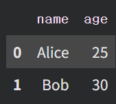

### 오늘의 TIL 

## 1. domain insight

# "월세 내느니 차라리" ... 4050 큰손 제친 2030 '생존매수' 

https://www.hankyung.com/article/2026110211341

요약: 올해 9월까지 집계된 경매로 집을 매수한 사람이 30대가 약 35%로 가장 높았다. 기존에 경매시장은 비교적 현금이 충분하고 은퇴를 준비하던 4050 세대였지만 지속된 매매, 월세, 전세 가격의 상승으로 부담을 느낀 젊은 세대들이 '생존'을 위한 매수를 한 것이다. 2030의 합계는 대략 41%로 10명중 4명 꼴에 해당하는 셈이다. 한 경제학과 교수는 각종 규제로 매매 시장에 진입하기 어려운 청년층의 마지막 주거 사다리로 경매시장에 눈을 돌리고 있다고 말했다. 
추가) 청년들이 경매에 눈을 들인 이유로는 일단 경매로 집을 사게 될 경우 토지거래허가제 등 실거주 의무를 적용받지 않는다. 

Q1.이번 정부가 집값을 잡지 못한 원인은 무엇일까? 

A. (1) 정책 밖의 요인

    ㄴ 누적된 공급 부족: 60만 가구의 착공 물량 부족과 금리 하락 

    ㄴ 유동성 : 반도체 호황기로 인한 많은 유동성이 시중에 넘쳐난다

Q2. 집 값을 내리기 위한 방안은? 
    ㄴ 공급 확대

    ㄴ 빠른 공급

    ㄴ 매물 유도 

Q3. 집값 하락과 안정 중 무엇을 목표로 해야하고, 각각 누가 이득이고 누가 손해일까? 

    ㄴ 무주택자를 위해서는 집값 하락
    
    ㄴ 실거주 주택자(집이 재산의 대부분이라 대출만 남을 가능성)

    ㄴ 전세 세입자(집값이 전세금보다 낮아지면 역전세 위험)

    ㄴ 은행, 건설사(담보가치 하락, 미분양)


# "학생한테 맞을 줄은" ... 교사들 사비 털어 가입한 '보험'

https://www.hankyung.com/article/2026110211291

요약: 교권 침해가 심해지면서 보험에 드는 교사들이 증가하고 있다. 보험사들도 이러한 수요에 맞춰 교직원 특화 상품들을 선보이고 있다. 한화손해보험에 따르면 2018년도에 가입한 인원1477명에서 8년 사이 6배가 늘어났다. 
교권 침해 피해를 지원하는 공적 제도도 있지만 보험과 차별화되는 점은 보장 방식이다. 공제사업이 실제 발생한 소송비용과 치료비등을 지원하는데 초점을 맞춘다면, 보험은 약관에서 정한 침해 사실이 인정되면 일정한 보험금을 지급한다. 


Q1. 교권 침해의 영역에는 무엇이 있을까?

    ㄴ 학생에 의한 침해 - 폭언, 폭행, 성희롱
    
    ㄴ 학부모에 의한 침해 - 악성민원과 소송

    ㄴ 정신적 피해 - 우을증, 공황장애, PTSD


Q2. 어떤 요인이 이전과 다른 형태의 교권 침해를 만들었을까?

    ㄴ 법, 제도 변화 : 아동학대 관련 법의 적용 범위 확대 

    ㄴ 학부모 문화 변화 : 과보호 경향, 교사에게 직접 연락하기 쉬워진 환경

 **교권보호위원회 심의는 지난해 4034건으로 2020년 1197건의 3배가 넘는다** 

    ㄴ 교권 침해가 3배 늘었다로 읽으면 안됨

    ㄴ 2020년은 원격수업의 해이기 때문에 기준 연도 자체가 비정상적으로 낮다(주의해서 읽기)


## 2. Python Grammar

클래스 : 붕어빵 틀

객체 : 붕어빵 


```python

import cv2 #이미지/영상 처리에 특화된 라이브러리,
import matplotlib.pyplot as plt
from google.colab.pathces import cv2_imshow 
# 구글 코랩 전용으로 패치한 cv2_imshow()함수 -> 이미지 보여주는 함수 


```python
__version__ #버전확인
__init__  # 초기화 
```
왜 이런형식이고 어떤 상황에서 쓰일까? 

ㄴ 던더(dunder, double underscore) : 파이썬이 특별한 의미로 미리 정해놓고 자동으로 알아서 호출/인식하는 예약된 이름 


```python
class Student:
    def __init__(self.name):
        self.name = name

print("틀 자체:", Student)
print("틀의 타입:', type(Student))
print()
```
__init__은 던더인데 굳이 정의를 해야하나? 그리고 왜 파라미터에는 self 와 name 두개가 있는걸까? 

ㄴ 정의부분 : __init__이라는 이름을 쓰면 자동으로 실행해주겠다는 약속만 미리 정해놓은 것, 그 안의 내용은 비어있는 상태 

ㄴ self : 

```python
try: #위험할 수 있는 코드
    s = Student('hojae')
except TypeError as e:
    print('에러:', e)
    #에러종류 & 에러가 났을 때 할 일 
```
응답
ㄴ 에러: __init__() takes 1 positional argument but 2 were given 

Student('hojae')로 1개만 넘겼는데 2개를 줬다고 에러 

Student('hojae')를 실행하면 지금 새로 만들어진 객체 + 이름까지 전달 하지만 받는 자리를 name 하나밖에 안만들어서 에러가 난다. 


```python

image = cv2.imread('/content/dog1.PNG')
gray_image= cv2.cvtColor(image,cv2.BGR2GRAY)
cv2_imshow(gray_image)
cv2.waitKey(0)
cv2.imwrite('gray.png,gray_image)

```

imread(경로): 이미지 읽기 함수
cv2.cvtColor(이미지, 변환코드): convert color 
cv2.waitKey(숫자): cv2.imshow()로 띄운 이미지 창이 얼마나 오래 떠있을지 
cv2.imwrite(파일경로, 이미지배열): 메모리에 있는 이미지 데이터를 실제 파일로 저장 

```python
import numpy as np
import time

data_list = list(range(1,1000001))
data_array = np.array(data_list)

```
time과 datetime의 차이 

time모듈은 컴퓨터가 계산하기 좋은 숫자 형태의 시간을 다루는 데 특화

datetime은 사람이 읽기 좋은 날짜/시간을 다루는 데 특화 

data_array는 어느 형태로 출력? 

파이썬 리스트처럼 각 숫자를 따로 관리하던 느슨한 구조에서 99999개의 같은 타입 숫자들이 하나의 고정된 블록으로 빽뺵하게 저장된 구조 


```python

data_list = list(range(1,100001))
data_array = np.array(data_list)

# 비교 - 1
# 반목문을 사용한 연산
start_time = time.time()

result_list = []
# 파이썬 반목문, 요소를 하나씩 꺼내 계산하고 결과를 리스트에 추가
for x in data_list:
    result_list.append(x * 2)

end_time = time.time()
loop_duration = end_time - start_time

print(f"루프를 사용한 연산 시간: {loop_duration:.6f}초")
```

:.6f가 뭐지? 

ㄴ "소수점 여섯째 자리까지 보여줘"

time.time()은 실행될 때의 시간이 서로 다르기 때문에 같은 값이 아니다 

```python

student = {
    "회원 ID" : "S001", 
    "학습 시간" : 12.5,
    "제출 횟수" : 4,
    "만족도": "높음",
    "수료 여부" : True
  
}

print(student["회원 ID"])
```

딕셔너리는 **key로 인덱싱** 적용해야한다 

```python

    {"회원 ID": "S001", "학습 시간": 12.5, "제출 횟수": 4, "만족도": "높음", "수료 여부": True},
    {"회원 ID": "S002", "학습 시간": 8.0, "제출 횟수": 2, "만족도": "보통", "수료 여부": False},
    {"회원 ID": "S003", "학습 시간": 15.0, "제출 횟수": 5, "만족도": "높음", "수료 여부": True}
]

print(students[0]["회원 ID"])
```
리스트 안에 딕셔너리 가능 

set(집합)은 중복 없다 


```python
import numpy as np 

hours = np.array([12.5, 8.0, 15.0], dtype="float64")

print(type(hours))
print(hours.dtype)
```

출력값이 다른 이유 : 

type(hours): hours라는 변수 자체가 어떤 종류의 객체냐 

hours.dtype : "그 그릇 안에 담긴 내용물이 어떤 자료형이냐" 


```python
df = pd.DataFrame({'name':['Alice','Bob'],'age':[25,30]})
```



ㄴ 출력 결과 

key 값: 열 이름
value 값: 그 열의 데이터 

